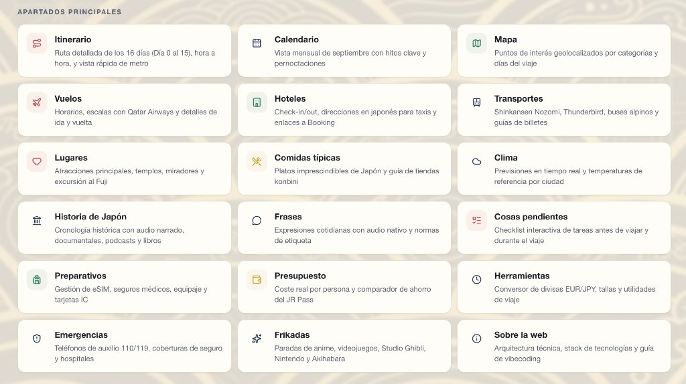
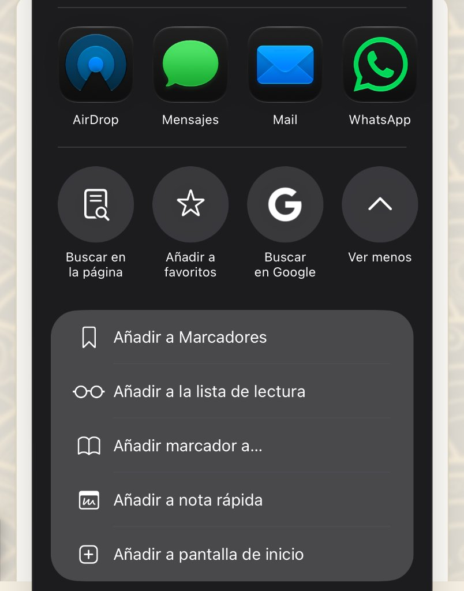
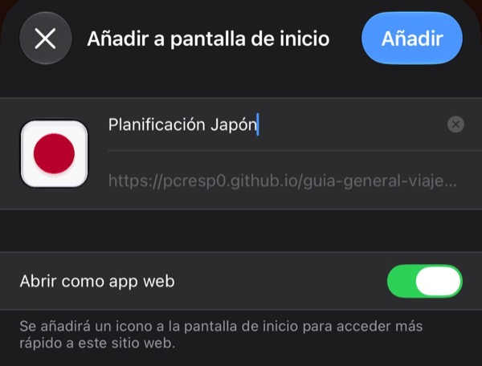
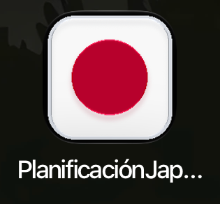

# 🗻 Guía General de Viaje a Japón 🇯🇵

[](https://react.dev/)
[](https://vitejs.dev/)
[](https://tailwindcss.com/)
[](https://developer.mozilla.org/en-US/docs/Web/Progressive_web_apps)
[](https://github.com/pCresp0/guia-general-viaje-japon)

Guía de viaje interactiva, *mobile-first* e instalable como **Progressive Web App (PWA)**, basada en una ruta completa de 16 días por Japón (Tokio, Kioto, Osaka, Kanazawa, Takayama, Valle de Kiso/Magome y Monte Fuji) realizada en **septiembre de 2026**.

Concebida con un doble propósito:
1. **Guía pública abierta:** Para que cualquier persona que esté organizando o soñando con un viaje a Japón pueda ver de forma práctica y real qué ruta seguir, qué trenes tomar, dónde alojarse, qué comer y qué preparativos tener listos.
2. **Plantilla viva de código abierto:** Para que desarrolladores o entusiastas del **vibecoding con IA** puedan clonar la aplicación y utilizarla como base para documentar o planificar su propio viaje a cualquier destino del mundo.

Esta plataforma sustituye por completo a los pesados documentos PDF, hojas de cálculo complejas y mensajes perdidos en chats grupales, unificando todo en una web moderna, reactiva y **100% operativa sin conexión a internet**.

---

## 🌐 Demo en Vivo en GitHub Pages

La versión oficial en producción está disponible públicamente en:

👉 **[https://pcresp0.github.io/guia-general-viaje-japon/](https://pcresp0.github.io/guia-general-viaje-japon/)**

---

## 🏛️ Arquitectura: Cero Backend y SSOT

El proyecto sigue una filosofía extrema de **disponibilidad y resiliencia offline**: en un viaje internacional, en túneles del Shinkansen o en zonas montañosas de los Alpes Japoneses, depender de la nube para consultar un billete, una reserva o una dirección no es viable.

1. **Single Source of Truth (SSOT) en el cliente:** Todos los datos (itinerario minuto a minuto, hoteles, vuelos, transportes, meteorología, historia y listas de tareas) residen en módulos JavaScript estructurados en `src/data/`. Cargar la web equivale a descargar la base de datos íntegra.
2. **PWA Offline-First (Workbox):** Mediante `vite-plugin-pwa`, la app instala un *Service Worker* que almacena en caché todos los recursos estáticos (código, estilos, fuentes, mapas e imágenes). Tras la primera carga, la aplicación abre y navega instantáneamente sin consumir datos móviles.
3. **Persistencia Local (`localStorage`):** El estado dinámico (tareas completadas en la checklist de preparativos, idioma seleccionado, filtros activos) se guarda exclusivamente en el dispositivo del usuario. Sin cuentas, sin contraseñas y sin telemetría invasiva.

---

## 🛠️ Tecnologías y Stack Técnico

* **React 19 & Vite 8:** Arquitectura modular de componentes, renderizado reactivo ultrarrápido y Hot Module Replacement (HMR) casi instantáneo.
* **Tailwind CSS v4 & Mobile-First:** Maquetación con utilidades atómicas, soporte de *Safe Area Insets* (notch y barras de navegación de iOS/Android) y una paleta inspirada en la estética japonesa tradicional (*Shu* bermellón, *Índigo*, *Sakura*, *Paper*).
* **Navegación por Gestos Móviles (`react-swipeable`):** Deslizar desde la pantalla hacia la derecha abre el menú lateral tipo cajón; deslizar hacia la izquierda lo cierra.
* **Mapas Vectoriales (Leaflet + OpenStreetMap):** Solución de cartografía ligera, libre de costes de Google Maps API y sincronizada con el itinerario y los puntos de interés.
* **Web Speech API (Text-to-Speech nativo):** Reproductor de audio integrado que sintetiza voz de forma nativa en el navegador para escuchar la historia de Japón sin descargar archivos de audio pesados.
* **Sistema Multi-idioma Propio (React Context):** Arquitectura propia sin librerías pesadas, con soporte completo para **Español 🇪🇸, English 🇬🇧, Français 🇫🇷 y Tagalog 🇵🇭**.
* **Buscador Global Reactivo:** Motor de búsqueda en memoria que indexa instantáneamente toda la aplicación y navega al resultado exacto con resalte luminoso.
* **Meteorología con Open-Meteo:** Conexión con la API libre de Open-Meteo para las ciudades de la ruta, con caché local de 12 horas.
* **Modo Impresión & Exportación PDF (`@media print`):** Estilos y vistas dedicadas para imprimir el itinerario y la historia o guardarlos como PDF de respaldo sin batería.

---

## 📱 Secciones y Funcionalidades de la Web

<p align="center">
  
</p>

La aplicación está organizada en **19 secciones temáticas**, diseñadas para acompañar cada fase de la planificación y el día a día en Japón:

### ⛩️ Navegación Principal
| Icono | Sección | Descripción |
| :--- | :--- | :--- |
| ⛩️ | **Inicio** (`#inicio`) | Bienvenida interactiva, resumen de la ruta de 16 días, tips de navegación y canales de contacto directo. |
| 🗓️ | **Itinerario** (`#itinerario`) | Doble modo: **Vista Detallada** (horarios, avisos de efectivo, lore) y **Vista Rápida** (línea visual con paradas enlazadas al mapa). Incluye botón de exportación limpia a PDF/impresión. |
| 📅 | **Calendario** (`#calendario`) | Desglose mensual y semanal de las 16 jornadas con hitos clave, pernoctaciones y traslados. |
| 🗺️ | **Mapa Interactivo** (`#mapa`) | Cartografía vectorial offline basada en OpenStreetMap + Leaflet con filtros por categoría (Lugares, Hoteles, Transportes) y por días específicos. |

### 🚅 Viaje y Logística
| Icono | Sección | Descripción |
| :--- | :--- | :--- |
| ✈️ | **Vuelos** (`#vuelos`) | Desglose de los vuelos internacionales (Madrid–Doha–Narita) con escalas, horarios, aeronaves y operadoras. |
| 🏨 | **Hoteles** (`#hoteles`) | Fichas de alojamientos con direcciones en japonés (kanji para taxis), horarios de check-in/out e indicaciones de llegada. |
| 🚄 | **Transportes & Billetes** (`#transportes`) | Fichas técnicas y didácticas de Shinkansen Nozomi, Thunderbird, Shinano y Nohi Bus con horarios, tarifas de referencia por persona, métodos de acceso oficial (Smart EX / IC Card / máquinas JR), normativa de equipaje y guía de Visit Japan Web. |
| 💰 | **Presupuesto & JR Pass** (`#presupuesto`) | Desglose transparente de costes y comparador matemático exhaustivo que analiza por qué no compensa el JR Pass tras la subida de precios de 2023. |

### 🏯 Guía y Cultura
| Icono | Sección | Descripción |
| :--- | :--- | :--- |
| 🏛️ | **Lugares & Lore** (`#lugares`) | 24 guías a fondo de templos, santuarios, castillos, miradores y distritos clave con datos históricos, horarios y consejos prácticos. |
| 🍜 | **Gastronomía & Konbini** (`#comidas`) | Platos imprescindibles de la cocina japonesa (ramen, wagyu, okonomiyaki, takoyaki, matcha) y guía práctica de conveniencia (*konbini* 7-Eleven, FamilyMart y Lawson). |
| 📜 | **Historia & Multimedia** (`#historia`) | Periodos históricos narrados con reproductor de voz Text-to-Speech nativo, podcasts de Apple, documentales de YouTube y libros con lectura online. |
| 👾 | **Cultura Pop (Frikadas)** (`#frikadas`) | Puntos de interés cruzados con anime, videojuegos y cine (Ghibli, Pokémon, Nintendo, Akihabara). |

### 🎒 Preparación y Seguridad
| Icono | Sección | Descripción |
| :--- | :--- | :--- |
| ✅ | **Cosas Pendientes** (`#pendientes`) | Checklist interactiva con persistencia en `localStorage` dividida en tareas esenciales antes de viajar y durante el viaje con fechas límite. |
| 🎒 | **Maleta & Preparativos** (`#preparativos`) | Checklist exhaustiva de equipaje por categorías (documentación, electrónica, ropa, botiquín e higiene) con guardado automático en `localStorage`. |
| 🚨 | **Emergencias & Seguro** (`#emergencias`) | Cobertura médica internacional Heymondo (hasta 5.000.000 €), asistencia 24h, reclamación AirHelp Plus, teléfonos de emergencia (110, 119) y datos de la Embajada de España en Tokio. |

### 🧮 Utilidades
| Icono | Sección | Descripción |
| :--- | :--- | :--- |
| 🌦️ | **El Clima en Japón** (`#clima`) | Predicciones meteorológicas en vivo a 7 días vía Open-Meteo, condiciones generales del mes activo y medias históricas de temperatura y lluvia. |
| 🗣️ | **Frases y Etiqueta** (`#frases`) | Guía fonética de frases útiles con pronunciación nativa y normas esenciales de protocolo y modales japoneses. |
| 🧮 | **Herramientas de Viaje** (`#herramientas`) | Conversor bidireccional de divisas (EUR ↔ JPY) con botones rápidos, tablas de equivalencia de tallas internacionales y comprobador de caché offline. |
| ℹ️ | **Sobre la web** (`#about`) | Explicación detallada de la arquitectura técnica (SSOT), comandos de clonación y guía práctica de vibecoding con IA. |

---

## 📂 Estructura del Proyecto

```text
guia-general-viaje-japon/
├── public/                 # Favicons, iconos PWA, manifest y recursos estáticos
├── src/
│   ├── components/         # Componentes reutilizables (fichas de tren, mapa, nav, footer, modales, print views...)
│   ├── context/            # Contextos de React (HighlightContext para buscador y navegación interna)
│   ├── data/               # Single Source of Truth (SSOT)
│   │   ├── trip.js         # Datos base del viaje, días del itinerario, vuelos, hoteles, presupuestos y notas
│   │   ├── content.js      # Capa de fusión e internacionalización de contenido estructurado
│   │   ├── mapData.js      # Puntos de interés geolocalizados para el mapa
│   │   ├── jrPass.js       # Comparativa de precios y análisis matemático del JR Pass
│   │   ├── guides.js       # 24 guías exhaustivas de lugares, templos, santuarios y lore
│   │   ├── guideImages.js  # Mapeo de fotografías e ilustraciones de guías
│   │   ├── insurance.js    # Coberturas de seguros de viaje Heymondo y teléfonos de asistencia
│   │   ├── prepChecklistData.js # Checklist completa de equipaje y maleta en 4 idiomas
│   │   ├── pending.js      # Checklist interactiva de tareas previas y durante el viaje
│   │   ├── history.js      # Datos históricos, podcasts, documentales y libros recomendados
│   │   ├── foods.js        # Guía gastronómica, platos típicos y sitios clave
│   │   ├── konbiniGuide.js # Guía completa de tiendas de conveniencia (7-Eleven, FamilyMart, Lawson)
│   │   ├── popCulture.js   # Cultura pop: anime, videojuegos, Ghibli, Nintendo y Akihabara
│   │   ├── fujiBookings.js # Excursión y herramientas de visibilidad del Monte Fuji
│   │   ├── weatherData.js  # Clima de referencia de cada ciudad de la ruta
│   │   ├── weatherMonthly.js # Estadísticas meteorológicas mensuales e históricas
│   │   ├── searchIndex.js  # Índice precomputado del buscador global
│   │   └── locales/        # Traducciones completas a inglés, francés y tagalo
│   ├── i18n/               # Contexto React de internacionalización (es, en, fr, tl) y diccionarios UI
│   ├── pages/              # 19 vistas principales de la aplicación (Inicio, Itinerario, About...)
│   ├── utils/              # Utilidades auxiliares (fecha, moneda, TTS, slugs, etc.)
│   ├── App.jsx             # Enrutador principal, layout general y Error Boundary
│   ├── main.jsx            # Punto de entrada de React y registro del Service Worker PWA
│   └── index.css           # Tokens de diseño y utilidades de Tailwind CSS v4
├── index.html              # Plantilla HTML base, etiquetas OpenGraph y favicons
├── vite.config.js          # Configuración de Vite y plugin de PWA con Workbox
└── README.md
```

---

## 🚀 Despliegue y Puesta en Marcha Local

El código fuente está listo para ejecutarse localmente con **Node.js** (versión 18 o superior recomendada):

1. **Clonar el repositorio:**
   ```bash
   git clone https://github.com/pCresp0/guia-general-viaje-japon.git
   cd guia-general-viaje-japon
   ```

2. **Instalar dependencias:**
   ```bash
   npm install
   ```

3. **Iniciar el servidor de desarrollo local:**
   ```bash
   npm run dev
   ```
   Abre [http://localhost:5173](http://localhost:5173) en tu navegador para ver la aplicación funcionando con recarga en caliente (HMR).

4. **Compilar para producción:**
   ```bash
   npm run build
   ```
   Generará la carpeta `dist/` optimizada y el Service Worker empaquetado para su despliegue en cualquier proveedor estático (**GitHub Pages**, **Vercel**, **Netlify** o **Cloudflare Pages**).

### 🌐 Despliegue Automático en GitHub Pages

El repositorio incluye un flujo de automatización listo para producción (`.github/workflows/deploy.yml`) que compila la web con Vite y la publica automáticamente en GitHub Pages en cada `git push origin main`:

1. En GitHub, entra en tu repositorio y dirígete a **Settings** ➔ **Pages** (en el menú lateral izquierdo).
2. En la sección **Build and deployment ➔ Source**, selecciona **GitHub Actions** (en vez de *"Deploy from a branch"*).
3. Si cambias el nombre del repositorio, edita la propiedad `base` en `vite.config.js` con el nombre de tu repositorio (por ejemplo `base: '/mi-viaje-japon/'`).
4. En la sección **Custom domain**, déjalo vacío a menos que tengas un dominio propio.
5. El workflow de Actions compilará la app y publicará la web automáticamente con HTTPS y soporte PWA.

---

## 🤖 Clonación, Personalización y Vibecoding

Esta web ha sido diseñada intencionadamente para que **cualquier persona pueda reutilizarla como plantilla** para su propio viaje:

### Opción A: Desarrollo Clásico
Si tienes conocimientos de desarrollo web (JavaScript / React):
* Modifica los datos de `src/data/trip.js` con tus fechas, ciudades, horarios, vuelos, hoteles y actividades.
* Ajusta las coordenadas y puntos de interés en `src/data/mapData.js`.
* Personaliza tu lista de tareas en `src/data/pending.js`.
* Los componentes visuales de la aplicación se alimentan directamente de estos archivos y reflejarán tus cambios de inmediato sin tocar bases de datos.

### Opción B: Vibecoding con Asistentes de IA
Si prefieres no programar o quieres montar tu guía en cuestión de minutos, puedes utilizar IDEs y herramientas con IA como **Antigravity**, **Cursor** o **Visual Studio Code** (con extensiones o agentes como **GitHub Copilot** o **Claude Code**). Una vez clonado el repositorio, pídele al agente en lenguaje natural:
> *"Quiero adaptar esta web para mi próximo viaje a Japón de 12 días en primavera. Estas son mis fechas, mis hoteles y las ciudades que visitaré: [pega aquí tus notas]. Actualiza los datos de `src/data/trip.js` y `src/data/mapData.js` manteniendo intacta la estructura y los componentes."*

La IA actualizará los módulos de datos respetando las interfaces y tendrás tu propia Progressive Web App personalizada lista para compartir con amigos o compañeros de viaje.

---

## 📴 Cómo Instalar la Web como App en el Móvil (PWA)

Al tratarse de una Progressive Web App (PWA), no necesitas buscarla en App Store ni en Google Play:

* **En iPhone / iPad (Safari):**
  1. Abre la web en Safari.
  2. Pulsa el botón **Compartir** (icono del cuadrado con la flecha hacia arriba).
  3. Desliza y selecciona **"Añadir a pantalla de inicio"**.
  4. Confirma el nombre y pulsa **"Añadir"** en la esquina superior derecha.

* **En Android (Chrome / Brave / Edge):**
  1. Abre la web en el navegador.
  2. Pulsa el menú de tres puntos (⋮) en la esquina superior derecha.
  3. Selecciona **"Instalar aplicación"** o **"Añadir a la pantalla principal"**.

| 1. Selecciona «Añadir a pantalla de inicio» | 2. Confirma y pulsa «Añadir» | 3. Acceso directo instalado |
| :---: | :---: | :---: |
|  |  |  |

---

## 📬 Contacto y Soporte

Si tienes cualquier duda organizando tu viaje a Japón, quieres hacer una consulta sobre la ruta o necesitas consejos de viaje, abajo del todo en el **footer de la web** tienes disponibles mis canales y redes sociales de contacto directo.

* **LinkedIn:** [linkedin.com/in/pablocrespobellido](https://www.linkedin.com/in/pablocrespobellido/)
* **Repositorio oficial:** [github.com/pCresp0/guia-general-viaje-japon](https://github.com/pCresp0/guia-general-viaje-japon)
* **Desarrollado por:** Pablo Crespo Bellido (2026)
